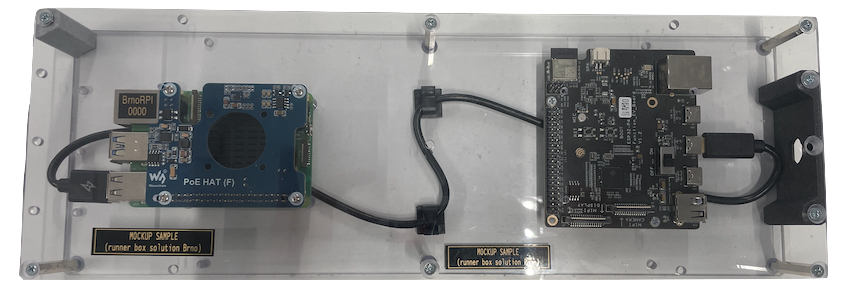

# rpi-box

This repository gives the mechanical design for a continuous-integration runner (CI runner) in a 19-inch rack.

A CI runner is a Raspberry Pi that runs your tests.
Each CI runner is in one box with its test boards.
You put the boxes on a rack shelf.
The RPI-PDU supplies 5 V direct current (DC) to the boxes.
The SEQ-PDU connects the rack to the mains supply.
The SEQ-PDU starts the sockets one after the other.
This start sequence prevents a large current peak.

The pages that follow give the parts lists, the drawings, and the assembly steps.

---

## [RPI-BOX](docs/box/README.md) (350 mm × 70 mm × 43 mm)

The RPI-BOX is the standard box.
It holds one Raspberry Pi and the test boards.

The shelf is 350 mm deep.

- If you put the boxes on end, a 2U space holds 10 boxes.
- If you put the boxes flat, a 1U space holds 6 boxes.

The box has a GX12 connector for the 5 V supply.
The box has a label on the front.

---

## [RPI-BOX-Double](docs/box-double/README.md) (350 mm × 120 mm × 43 mm)

The RPI-BOX-Double is the wide box.
Use this box when the test boards or the cables need more space.

The shelf is 350 mm deep.

- If you put the boxes on end, a 3U space holds 10 boxes.
- If you put the boxes flat, a 1U space holds 3 wide boxes and 1 RPI-BOX.

The wide box uses the same GX12 connector as the RPI-BOX.
The wide box uses the same back plate as the RPI-BOX.
The wide box uses the same label holder as the RPI-BOX.

---

## [RPI-PDU](docs/pdu/README.md)

The RPI-PDU is a 1U power-supply unit.
It supplies 5 V DC at 3 A to each of 20 boxes.
Each output uses a GX12 cable.
The case can hold a maximum of two shelves of boxes.

---

## [SEQ-PDU](docs/seq-pdu/README.md)

The SEQ-PDU is a 3U mains panel.
The panel has six sockets.
Each socket has a delay before it starts.
The panel has a 16 A circuit breaker, type Z.
This circuit breaker opens before the upstream circuit breaker.
A fault then stays in this rack.

---

## How the parts work together

- The SEQ-PDU is the mains inlet for the rack.
- The six sockets of the SEQ-PDU start in sequence.
- Connect the RPI-PDU to one of these sockets.
- The RPI-PDU supplies 5 V to a maximum of 20 boxes.
- Put each CI runner in an RPI-BOX or in an RPI-BOX-Double.
- A short GX12 cable supplies 5 V from the RPI-PDU to the box.
- Use the RPI-BOX-Double when the test boards need more width.
- Write the runner name, the test boards, and the cable notes on the front label.

Each base plate is 4 mm thick.
Each corner spacer is 35 mm long.
The external height of the box is 43 mm.
Put the screw heads below the surface of the base plate.
The boxes can then move against each other.

---

## Contents of this repository

- [RPI-BOX assembly procedure](docs/box/README.md)
- [RPI-BOX-Double assembly procedure](docs/box-double/README.md)
- [RPI-PDU parts list and schematic](docs/pdu/README.md)
- [SEQ-PDU parts list and schematic](docs/seq-pdu/README.md)
- [Photographs of shared parts](docs/shared/images)
- [Manufacturing files](models)

> [!WARNING]
> The RPI-PDU and the SEQ-PDU connect to 230 V alternating current (AC).
> 230 V AC can kill you.
> Do this work only if you have approval for mains wiring.

The license is the [MIT license](LICENSE).
