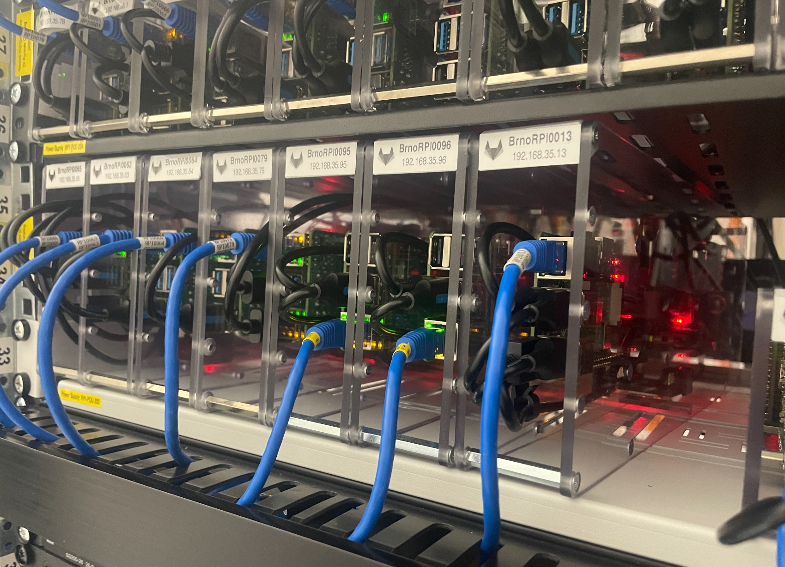
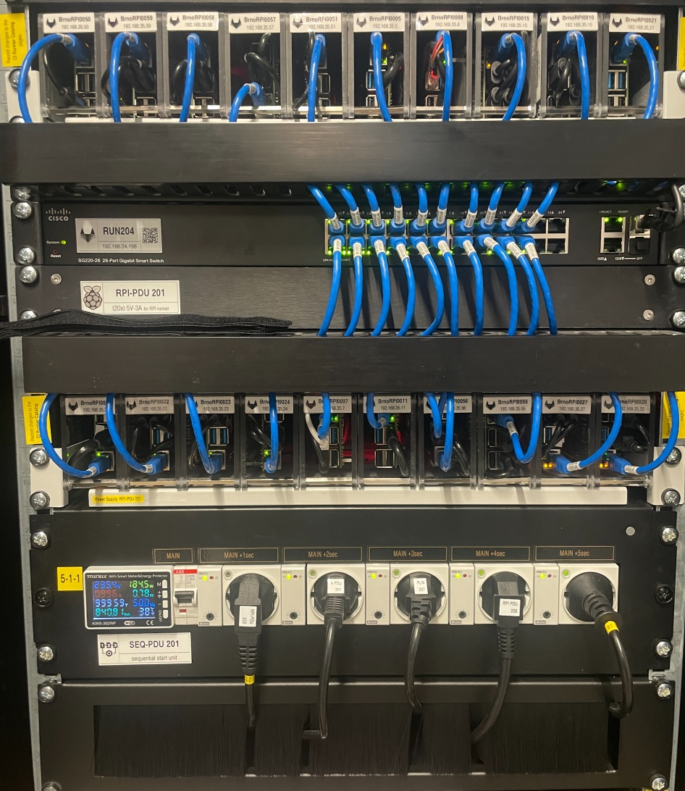
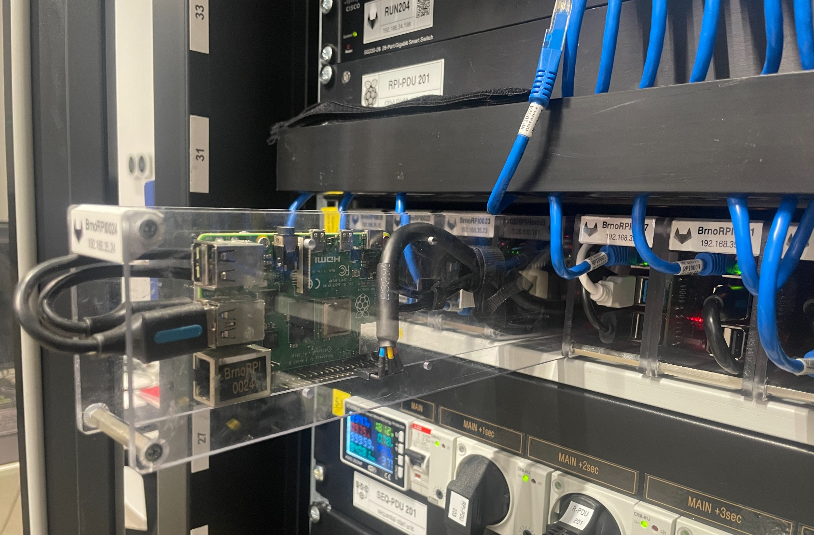
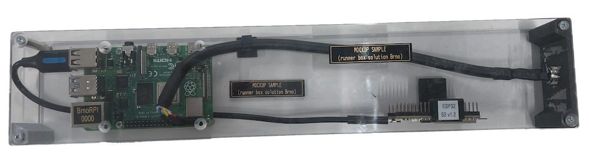
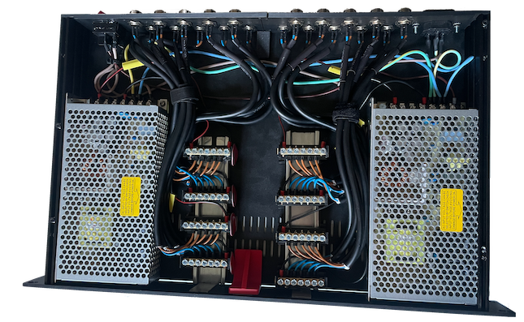
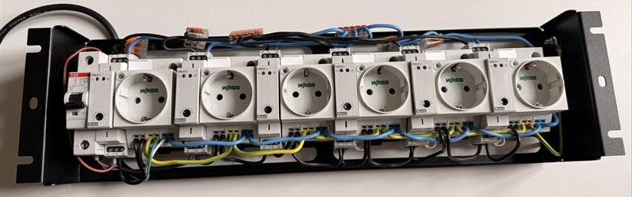

# Espressif RPI-BOX

We put this together because our test setups needed a shape we could repeat. A Raspberry Pi, a few Espressif dev kits, and the cables between them used to be a fresh pile of boards every time. A standard box turned that into the same setup, over and over, and made it much easier to keep track of.

## Why a box, and why a rack

We sized the boxes for a normal 19-inch rack on purpose. Stack them and you can keep a lot of setups in a small slice of the room, which is what we were after.

Cooling came with that choice. The sides stay open, so air just moves through the box, and we never had to hang a noisy fan on each one. A full rack stays quiet. The plates are polycarbonate, so each box is its own little island: a stray wire has a much harder time shorting the setup next to it.

The other thing we like is that the whole example lives in the box. When someone needs to work close to the hardware, they slide it out of the rack, carry it to their desk, tweak whatever is misbehaving, and slide it back when they are done.

There are tidier ways to build a runner. A custom board with a Raspberry Pi Compute Module could put the USB ports exactly where you want them. We wanted something we could build without a board spin, so this one stays simple: ordinary connection hardware (screws, spacers, and DIN parts in standard ISO and DIN sizes) plus a handful of pieces from a normal home 3D printer. The printed parts cost very little.

Cables are the same story. In the Espressif office we have so many of these sets that we asked a company to make the leads for us. If you only need a few, the connectors are inexpensive, and the cables are an easy afternoon on a bench at home.

The base plates are the one part we have someone else cut. We buy them already sized, holes included, simply because we go through so many. You can still make them yourself from a sheet of polycarbonate. Each plate is a plain rectangle, with straight holes and straight edges, and nothing fancy cut out of it.

## Power that can feed the Pi and the dev kits

Then we had to get DC into the box, enough for the Raspberry Pi and for every dev kit hanging off it. We tried a lot of things — other layouts, other cable lengths, other cable types, other connectors — before we settled on the RPI-PDU.

It takes a single 1U, and from that one closed case we power two full shelves. A shelf of standard boxes, stood on end, is 2U and holds 10. A shelf of wide RPI-BOX-Double units is 3U and also holds 10. Either way, one supply feeds twenty setups, and the case stays electrically closed.

The row we actually use, top to bottom, is a shelf of 10 boxes, a cable organizer (1U), a 24-port switch (1U), the RPI-PDU (1U), another cable organizer (1U), and a second shelf of 10 boxes. With 2U shelves that row is 8U. With 3U shelves it is 10U. That is the space for 20 connected, powered setups. A standard 42U cabinet holds about 80 to 100 of these boxes.

The leads out to the boxes are ordinary round cable. They fall to the back of the rack and slip past one another, so they stay untangled.

## Starting the whole rack at once

The SEQ-PDU is there because a normal wall breaker does not like dozens of Raspberry Pi boards waking up in the same instant. After an outage the whole cabinet comes back together, and that spike is enough to trip the breaker.

The panel itself is deliberately simple. DIN time relays bring the sockets up one after another. We set the first socket to come on as soon as power returns, the second a second later, the next two seconds later, and so on. Most of those sockets feed an RPI-PDU. Where a box takes power from a PoE HAT, the network switch sits on a SEQ-PDU socket instead, and the same delay applies.

It has behaved better than we expected. Since the panel went in, bringing the whole cabinet up at once has not tripped the breaker.

---

## The hardware

This repository gives **the mechanical design** for a continuous-integration runner (CI runner) in a 19-inch rack.

A CI runner is a Raspberry Pi that runs your tests.
Each CI runner is in one box with its test boards.
You put the boxes on a rack shelf.
The RPI-PDU supplies 5 V direct current (DC) to the boxes.
The SEQ-PDU connects the rack to the mains supply.
The SEQ-PDU starts the sockets one after the other.
This start sequence prevents a large current peak.

The pages that follow give the parts lists, the drawings, and the assembly steps.

---

### [RPI-BOX](docs/box/README.md) (350 mm × 70 mm × 43 mm)

The RPI-BOX is the standard box.
It holds one Raspberry Pi and the test boards.

The shelf is 350 mm deep.

- If you put the boxes on end, a 2U space holds 10 boxes.
- If you put the boxes flat, a 1U space holds 6 boxes.

The box has a GX12 connector for the 5 V supply.
The box has a label on the front.

---

### [RPI-BOX-Double](docs/box-double/README.md) (350 mm × 120 mm × 43 mm)

The RPI-BOX-Double is the wide box.
Use this box when the test boards or the cables need more space.

The shelf is 350 mm deep.

- If you put the boxes on end, a 3U space holds 10 boxes.
- If you put the boxes flat, a 1U space holds 3 wide boxes and 1 RPI-BOX.

The wide box uses the same GX12 connector as the RPI-BOX.
The wide box uses the same back plate as the RPI-BOX.
The wide box uses the same label holder as the RPI-BOX.

---

### [RPI-PDU](docs/pdu/README.md)

The RPI-PDU is a 1U power-supply unit.
It supplies 5 V DC at 3 A to each of 20 boxes.
Each output uses a GX12 cable.
The case can hold a maximum of two shelves of boxes.

---

### [SEQ-PDU](docs/seq-pdu/README.md)

The SEQ-PDU is a 3U mains panel.
The panel has six sockets.
Each socket has a delay before it starts.
The panel has a 16 A circuit breaker, type Z.
This circuit breaker opens before the upstream circuit breaker.
A fault then stays in this rack.

---

## How the parts work together

- The SEQ-PDU is the mains inlet for the rack.
- The six sockets of the SEQ-PDU start in sequence.
- Connect the RPI-PDU to one of these sockets.
- The RPI-PDU supplies 5 V to a maximum of 20 boxes.
- Put each CI runner in an RPI-BOX or in an RPI-BOX-Double.
- A short GX12 cable supplies 5 V from the RPI-PDU to the box.
- Use the RPI-BOX-Double when the test boards need more width.
- Write the runner name, the test boards, and the cable notes on the front label.

Each base plate is 4 mm thick.
Each corner spacer is 35 mm long.
The external height of the box is 43 mm.
Put the screw heads below the surface of the base plate.
The boxes can then move against each other.

---

## Contents of this repository

- [RPI-BOX assembly procedure](docs/box/README.md)
- [RPI-BOX-Double assembly procedure](docs/box-double/README.md)
- [RPI-PDU parts list and schematic](docs/pdu/README.md)
- [SEQ-PDU parts list and schematic](docs/seq-pdu/README.md)
- [Photographs of shared parts](docs/shared/images)
- [Manufacturing files](models)

> [!WARNING]
> The RPI-PDU and the SEQ-PDU connect to 230 V alternating current (AC).
> 230 V AC can kill you.
> Do this work only if you have approval for mains wiring.

The license is the [MIT license](LICENSE).
