# RPI-BOX-Double (350 mm × 120 mm × 43 mm)

[Overview](../../README.md) · [Standard box](../box/README.md) · [Shelf power](../pdu/README.md)

The RPI-BOX-Double is the same box as the [RPI-BOX](../box/README.md), with a wider base plate.
The base plate is 350 mm × 120 mm.
The standard base plate is 350 mm × 70 mm.
Use this box when the test boards or the cables need more space.
You install the box in a 19-inch rack.

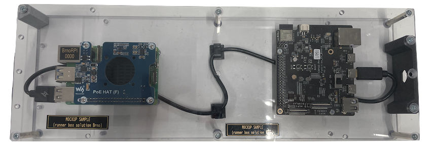

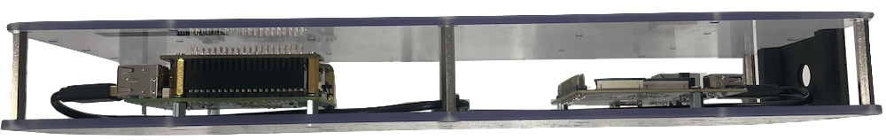

The shelf is 350 mm deep.

- If you put the boxes on end, a 3U space holds 10 boxes.
- If you put the boxes flat, a 1U space holds 3 wide boxes and 1 [RPI-BOX](../box/README.md).

Do the [RPI-BOX assembly procedure](../box/README.md).
Read the differences on this page first.
The parts list is for the wide box.
The column "Per box" is the quantity for one box.
The column "For 20 boxes" is the quantity for the batch.

> [!NOTE]
> The links in the tables go to example shops in Czechia.
> You can use a part that has the same specification.

---

## Differences from the RPI-BOX

- The base plates are 350 mm × 120 mm × 4 mm.
- Cut the base plates from the [PDF drawing](../../models/box-double/base-plate-plexi-350x120x4.pdf).
- The [DXF file](../../models/box-double/RpiBoxDouble.dxf) shows the same outline.
- The outline is 350 mm × 120 mm.
- Each box uses eight 35 mm M3 spacers.
- The RPI-BOX uses four of these spacers.
- Install the other four spacers along the long edges.
- These spacers keep the top base plate flat.
- The assembly photograph shows these spacers.
- Each box uses 16 screws, type M3×8.
- The Raspberry Pi uses four 8 mm M2.5 spacers.
- The Raspberry Pi uses eight screws, type M2.5×6.

These parts are the same as on the RPI-BOX:

- The back plate
- The label holder
- The Raspberry Pi
- The microSD card
- The two GX12 cables

The GPIO header is the pin header on the Raspberry Pi.

---

## Parts

### Parts that you order or make

| ID       | Per box | For 20 boxes | Item                                                       | Photograph                                                                                             |
| -------- | ------- | ------------ | ---------------------------------------------------------- | ------------------------------------------------------------------------------------------------------ |
| `id_010` | 2×      | 40×          | [Polycarbonate base plate, 350 mm × 120 mm × 4 mm][id_010] | 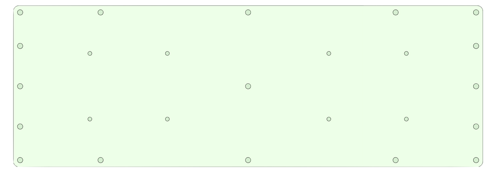                      |
| `id_020` | 1×      | 20×          | Cable, GX12-2F to a 2.54 mm Dupont header                  |      |
| `id_030` | 1×      | 20×          | Cable, GX12-2M to GX12-2M                                  | 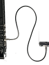 |

- Order base plate `id_010` from a plastics shop.
- Give the shop the [drawing][id_010].
- Cable `id_020` supplies 5 V from the GX12 connector to the GPIO header.
- The wire colors are in the [RPI-BOX procedure](../box/README.md).
- Cable `id_030` stays out of the box.
- Cable `id_030` connects the [RPI-PDU](../pdu/README.md) to the GX12 connector.
- A cable shop can make the two cables.
- The shop attaches a GX12 connector and a Dupont header.

### Parts that you buy

| ID       | Per box | For 20 boxes | Item                                                        | Photograph                                                                                             |
| -------- | ------- | ------------ | ----------------------------------------------------------- | ------------------------------------------------------------------------------------------------------ |
| `id_110` | 8×      | 160×         | [M3 spacer, female-to-female, 35 mm, nickel][id_110]        | 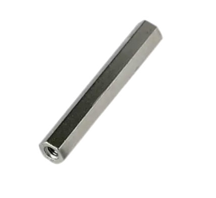                       |
| `id_120` | 4×      | 80×          | [M2.5 spacer, female-to-female, 8 mm, nickel][id_120]       | 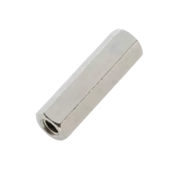                     |
| `id_130` | 16×     | 320×         | [Countersunk screw, Phillips head, DIN 965, M3×8][id_130]   | 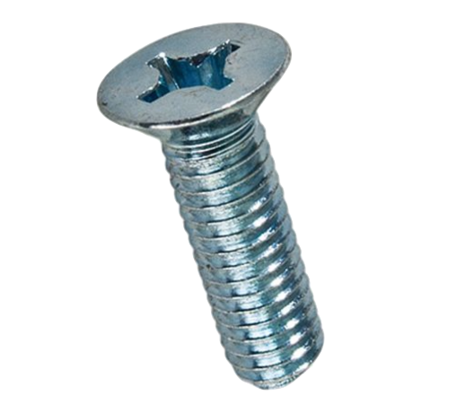 |
| `id_140` | 8×      | 160×         | [Countersunk screw, Phillips head, DIN 965, M2.5×6][id_140] |  |
| `id_150` | 1×      | 20×          | [Raspberry Pi 5, 4 GB RAM][id_150]                          | 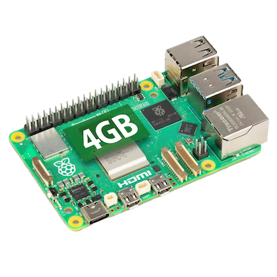                       |
| `id_160` | 1×      | 20×          | [microSD card, 64 GB, endurance type][id_160]               |                          |

### Parts that you print

Print these parts in polylactic acid (PLA).
The models are the same as the models for the RPI-BOX.
Use black PLA for the back plate.
Use white PLA for the label holder.

| ID       | Per box | For 20 boxes | Material  | Item                   | Photograph                                                                |
| -------- | ------- | ------------ | --------- | ---------------------- | ------------------------------------------------------------------------- |
| `id_210` | 1×      | 20×          | Black PLA | [Back plate][id_210]   | 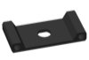  |
| `id_220` | 1×      | 20×          | White PLA | [Label holder][id_220] | 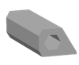 |

---

## Assemble the box

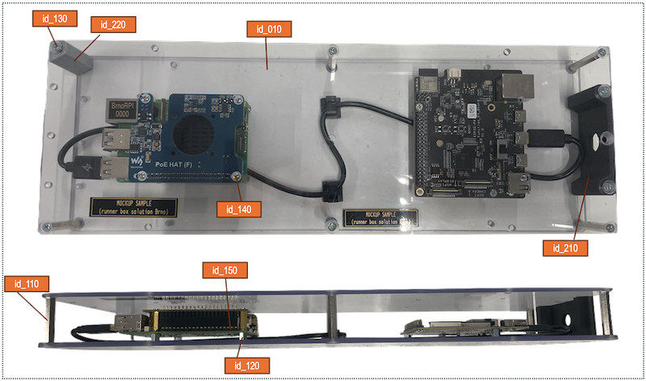

> [!CAUTION]
> Use the wire colors from the [RPI-BOX procedure](../box/README.md).
> Wrong polarity will destroy the Raspberry Pi.

01. Do the [RPI-BOX assembly procedure](../box/README.md).
02. Use base plates that are 350 mm × 120 mm.
03. Make the countersinks as in that procedure.
04. Put each screw head below the surface of the base plate.
05. Install eight 35 mm spacers `id_110`.
06. Install four of these spacers on the corners.
07. Install four of these spacers along the long edges.
08. Install the Raspberry Pi on the four 8 mm spacers.
09. Use the wire colors from the RPI-BOX procedure.
10. Keep the test boards and the cables inside the edges of the base plate.

---

[id_010]: ../../models/box-double/base-plate-plexi-350x120x4.pdf
[id_110]: https://www.gme.cz/v/1482458/di5m3x35-nikl-distancni-sloupek-35mm-m3-matka-matka
[id_120]: https://www.gme.cz/v/1482560/di5m25x08-nikel-distancny-stlpik-8mm-m25-matka-matka
[id_130]: https://www.briol.cz/cs/p-7-sroub-s-krizovou-drazkou-din-965-zapustna-hlava?v=25_42_542_96_383&c=39016.01
[id_140]: https://www.briol.cz/cs/p-7-sroub-s-krizovou-drazkou-din-965-zapustna-hlava?v=7_42_542_105_380&c=8121.01
[id_150]: https://rpishop.cz/raspberry-pi-5/6497-raspberry-pi-5-4gb-ram.html
[id_160]: https://www.alza.cz/samsung-microsdxc-64gb-pro-endurance-sd-adapter-d7095980.htm
[id_210]: ../../models/box/RPIBOX_BackPlate_v7.3mf
[id_220]: ../../models/box/LabelTag_v1.3mf
