# RPI-BOX (350 mm × 70 mm × 43 mm)

[Overview](../../README.md) · [Wide box](../box-double/README.md) · [Shelf power](../pdu/README.md)

A continuous-integration runner (CI runner) is a Raspberry Pi that runs your tests.
The RPI-BOX holds one CI runner and the test boards.
You install the box in a 19-inch rack.

The GPIO header is the pin header on the Raspberry Pi.

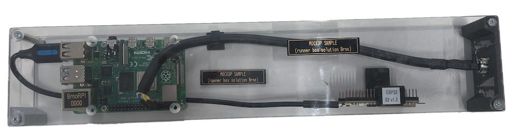

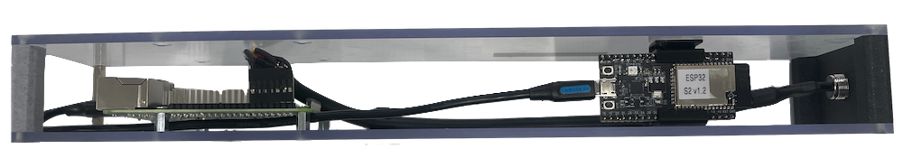

The shelf is 350 mm deep.

- If you put the boxes on end, a 2U space holds 10 boxes.
- If you put the boxes flat, a 1U space holds 6 boxes.

The box has two base plates and four spacers.
Each base plate is 4 mm thick.
Each spacer is 35 mm long.
The external height of the box is 43 mm.

This page gives the parts and the assembly steps for one box.
The column "For 20 boxes" gives the quantity for two shelves.
You put those boxes on end.

> [!NOTE]
> The links in the tables go to example shops in Czechia.
> You can use a part that has the same specification.

---

## Parts

### Parts that you order or make

| ID       | Per box | For 20 boxes | Item                                            | Photograph                                                                                             |
| -------- | ------- | ------------ | ----------------------------------------------- | ------------------------------------------------------------------------------------------------------ |
| `id_010` | 2×      | 40×          | Polycarbonate base plate, 350 mm × 70 mm × 4 mm | 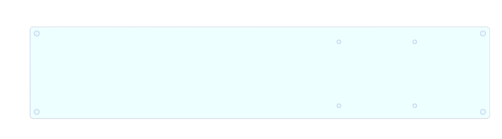                           |
| `id_020` | 1×      | 20×          | Cable, GX12-2F to a 2.54 mm Dupont header       |      |
| `id_030` | 1×      | 20×          | Cable, GX12-2M to GX12-2M                       | 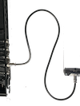 |

- Cut base plate `id_010` to 350 mm × 70 mm × 4 mm.
- This repository has no drawing for the 70 mm base plate.
- The wide box uses a different drawing.
- Cable `id_020` supplies 5 V to the GPIO header.
- The 5 V comes from the GX12 connector on the back plate.
- Cable `id_030` stays out of the box.
- Cable `id_030` connects the [RPI-PDU](../pdu/README.md) to the GX12 connector.
- A cable shop can make the two cables.
- The shop attaches a GX12 connector and a Dupont header.

### Parts that you buy

| ID       | Per box | For 20 boxes | Item                                                        | Photograph                                                                                             |
| -------- | ------- | ------------ | ----------------------------------------------------------- | ------------------------------------------------------------------------------------------------------ |
| `id_110` | 4×      | 80×          | [M3 spacer, female-to-female, 35 mm, nickel][id_110]        | 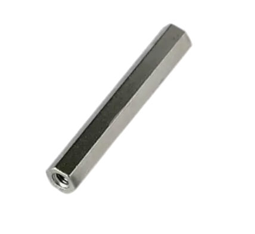                       |
| `id_120` | 4×      | 80×          | [M2.5 spacer, female-to-female, 8 mm, nickel][id_120]       | 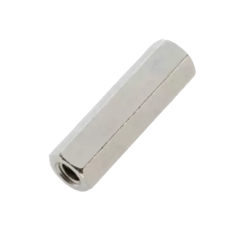                     |
| `id_130` | 8×      | 160×         | [Countersunk screw, Phillips head, DIN 965, M3×8][id_130]   | 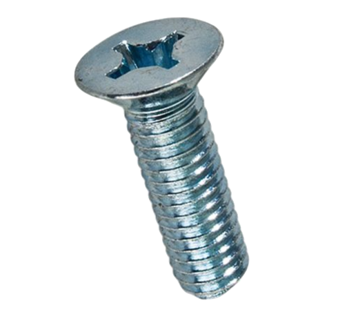 |
| `id_140` | 8×      | 160×         | [Countersunk screw, Phillips head, DIN 965, M2.5×6][id_140] |  |
| `id_150` | 1×      | 20×          | [Raspberry Pi 5, 4 GB RAM][id_150]                          | 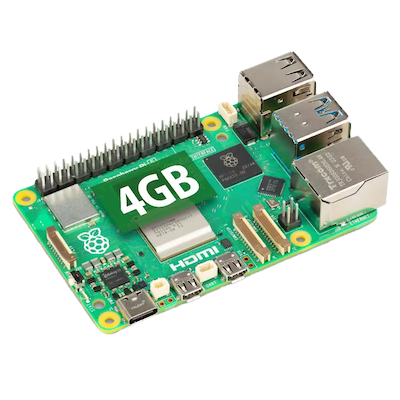                       |
| `id_160` | 1×      | 20×          | [microSD card, 64 GB, endurance type][id_160]               |                          |

### Parts that you print

Print these parts in polylactic acid (PLA).
Use black PLA for the back plate.
Use white PLA for the label holder.

| ID       | Per box | For 20 boxes | Material  | Item                   | Photograph                                                                |
| -------- | ------- | ------------ | --------- | ---------------------- | ------------------------------------------------------------------------- |
| `id_210` | 1×      | 20×          | Black PLA | [Back plate][id_210]   | 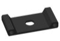  |
| `id_220` | 1×      | 20×          | White PLA | [Label holder][id_220] | 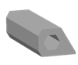 |

The back plate holds the GX12 connector.
The back plate also holds the cable.
The flat side of the back plate points out of the rack.
The label holder attaches to a front spacer.
The label gives the name of the CI runner.

---

## Tools

You need these tools:

- A drill press
- A countersink tool for M3 screws and for M2.5 screws
- A Phillips screwdriver
- Small pliers
- A bench that prevents electrostatic discharge
- Cable clips or hook-and-loop straps

---

## Prepare the base plates

> [!WARNING]
> Attach the base plate to the drill table before you cut.
> A drill bit that moves freely can cause injury to your hand.
> Use a countersink tool.
> Do not use a large drill bit in a handheld drill.

> [!NOTE]
> Put each screw head below the surface of the base plate.
> The boxes touch each other in the rack.
> A screw head above the surface prevents this movement.

Each box uses two base plates.
One base plate is the bottom plate.
One base plate is the top plate.
Prepare the two base plates before you assemble the box.

1. Find the holes for screws `id_130` and screws `id_140`.
2. Make a countersink in the outer side of each hole.
3. Make the countersink as deep as the screw head.
4. Put a screw in the hole.
5. Put a second base plate on the first base plate.
6. Make sure that the two base plates can move on each other.
7. If a screw head is above the surface, cut the countersink to a larger depth.

---

## Assemble the box

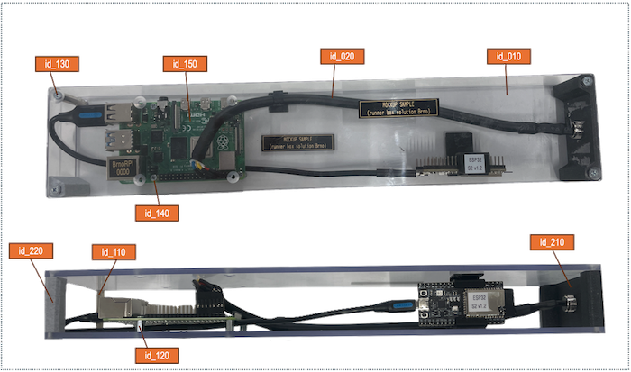

### 1. Install the bottom base plate

1. Put one base plate `id_010` on the workbench.
2. Use this base plate as the bottom plate.
3. Install four 35 mm spacers `id_110` on the four corners.
4. Attach each spacer with one M3×8 screw `id_130`.
5. Install the screws from the bottom side.
6. Tighten the screws until each screw head is below the surface.

The four spacers set the height of the box.
You attach the top base plate to these spacers.

### 2. Install the spacers for the Raspberry Pi

1. Find the four holes that hold the Raspberry Pi.
2. Do not use the four corner holes.
3. Install four 8 mm spacers `id_120` in the inner holes.
4. Attach each spacer from the bottom side with one M2.5×6 screw `id_140`.
5. Tighten the screws until each screw head is below the surface.

### 3. Install the Raspberry Pi

> [!CAUTION]
> Electrostatic discharge can cause damage to the Raspberry Pi.
> Touch a grounded metal surface before you touch the Raspberry Pi.

1. Put the Raspberry Pi `id_150` on the four 8 mm spacers.
2. Align the M2.5 holes with the spacers.
3. Attach the Raspberry Pi with M2.5×6 screws `id_140`.
4. Install these screws from the top side.

The Raspberry Pi is 8 mm above the base plate.

### 4. Install the microSD card

1. Write the system image for your CI runner to microSD card `id_160`.
2. Do this step before you put the card in the box.
3. Install the microSD card in the Raspberry Pi.

### 5. Install the GX12 connector on the back plate

1. Get cable `id_020`.
2. Remove the nut from the GX12 connector.
3. Put the GX12 connector into the hole from the flat side of back plate `id_210`.
4. Use the flat side as the outer side.
5. Install the nut on the outer side of the back plate.
6. Tighten the nut.
7. Make sure that the GX12 connector cannot turn.

The back plate and the GX12 connector are now one assembly.

### 6. Set the wire colors

> [!CAUTION]
> Use the pin colors that follow.
> Wrong polarity will destroy the Raspberry Pi.
> Do this check before you supply power.

1. Set these pin colors on the Dupont header of cable `id_020`:
   - **PIN1 = RED**
   - **PIN2 = BROWN**
   - **PIN3 = YELLOW**
   - **PIN7 = BLUE**
2. Connect these pins to the first row of the GPIO header.

> [!NOTE]
> This connection supplies power to the Raspberry Pi.

### 7. Attach the back plate

1. Get back plate `id_210` with cable `id_020` attached.
2. Align the back plate with the two rear spacers `id_110`.
3. Attach the back plate to these spacers with M3×8 screws `id_130`.
4. Point the GX12 connector to the rear of the box.
5. Put the cable in the box, toward the Raspberry Pi.

### 8. Connect the power cable to the Raspberry Pi

> [!CAUTION]
> Use the pin colors from step 6.
> Wrong polarity will destroy the Raspberry Pi.

1. Connect the Dupont header to the first row of the GPIO header.
2. Use the pin order from step 6.

### 9. Install the test boards and the cables

> [!CAUTION]
> Keep each test board and each cable inside the edges of the base plate.
> The boxes touch each other in the rack.
> A part that extends past an edge can cause damage to the equipment.

1. Put the test boards on the open area of the base plate.
2. Put the adapters and the test cables on the base plate.
3. Put these parts in front of the Raspberry Pi, or at the side of the Raspberry Pi.
4. Attach the cables with cable clips or with hook-and-loop straps.

### 10. Install the label holder

1. Attach label holder `id_220` to one front spacer `id_110`.
2. Use one M3×8 screw `id_130`.
3. Use the label holder as the mark for the top edge.
4. Put this edge up when you install the box in the rack.
5. Write the name of the CI runner on the label.
6. Write the names of the test boards on the label.
7. Write the cable notes on the label.

### 11. Install the top base plate

1. Get the second base plate `id_010`.
2. Use this base plate as the top plate.
3. Align the base plate with the four 35 mm spacers.
4. Attach the base plate with M3×8 screws `id_130`.
5. Install the screws from the top side.
6. Make sure that each outer screw head is below the surface.
7. Make sure that the top base plate is parallel to the bottom base plate.
8. Make sure that no screw catches a cable or a test board.

The assembly of the RPI-BOX is complete.

---

## Checklist

- Make sure that each outer screw head is below the surface.
- Make sure that the back plate is tight.
- Make sure that the GX12 connector cannot turn.
- Make sure that the Dupont header uses the colors from step 6.
- Make sure that the Dupont header is on the first row of the GPIO header.
- Make sure that the microSD card is in the Raspberry Pi.
- Make sure that the system image is on the microSD card.
- Make sure that the cables are attached.
- Make sure that no part extends past the base plate.
- Make sure that the label holder is installed.
- Make sure that the label gives the name of the CI runner.

---

## After you close the box

1. Install the software for the CI runner on the Raspberry Pi.
2. Use the same procedure that you use for your other CI runners.
3. Use the system image that you wrote to the microSD card in step 4.

The label identifies the box for the next person.
Write these items on the label:

- The name of the CI runner
- The names of the test boards
- The cable notes

The [RPI-PDU](../pdu/README.md) supplies power through cable `id_030`.

---

[id_110]: https://www.gme.cz/v/1482458/di5m3x35-nikl-distancni-sloupek-35mm-m3-matka-matka
[id_120]: https://www.gme.cz/v/1482560/di5m25x08-nikel-distancny-stlpik-8mm-m25-matka-matka
[id_130]: https://www.briol.cz/cs/p-7-sroub-s-krizovou-drazkou-din-965-zapustna-hlava?v=25_42_542_96_383&c=39016.01
[id_140]: https://www.briol.cz/cs/p-7-sroub-s-krizovou-drazkou-din-965-zapustna-hlava?v=7_42_542_105_380&c=8121.01
[id_150]: https://rpishop.cz/raspberry-pi-5/6497-raspberry-pi-5-4gb-ram.html
[id_160]: https://www.alza.cz/samsung-microsdxc-64gb-pro-endurance-sd-adapter-d7095980.htm
[id_210]: ../../models/box/RPIBOX_BackPlate_v7.3mf
[id_220]: ../../models/box/LabelTag_v1.3mf
