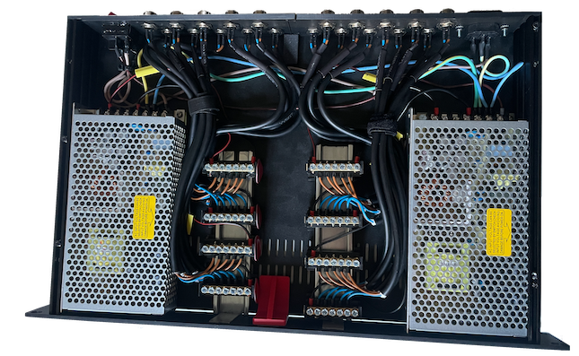
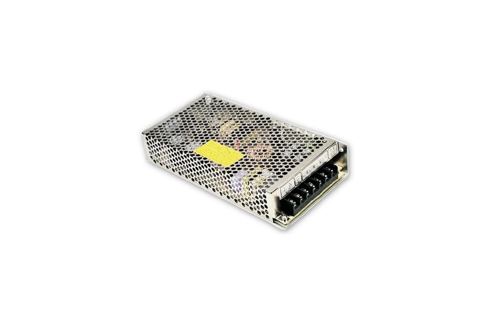
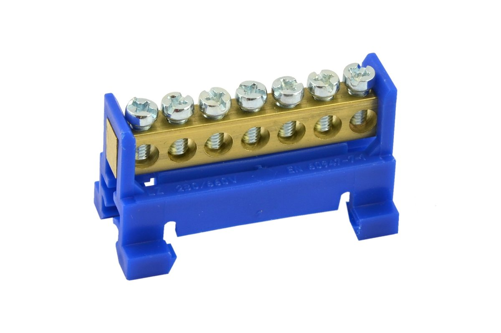
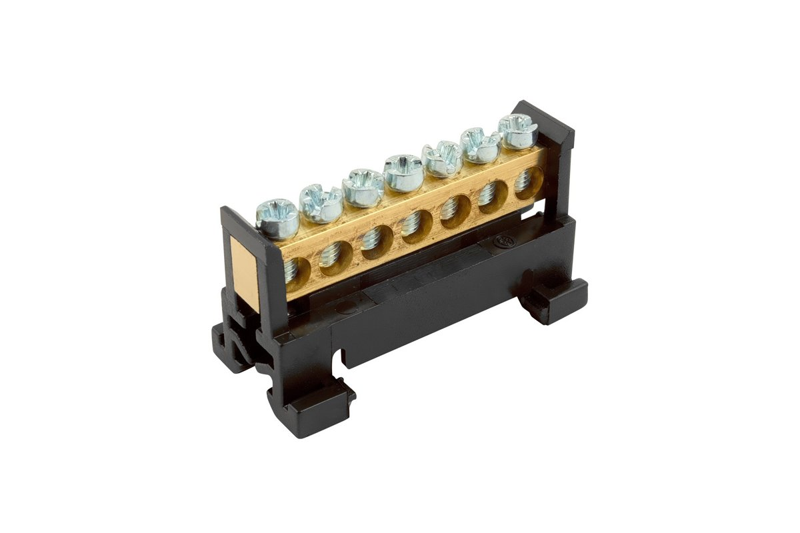
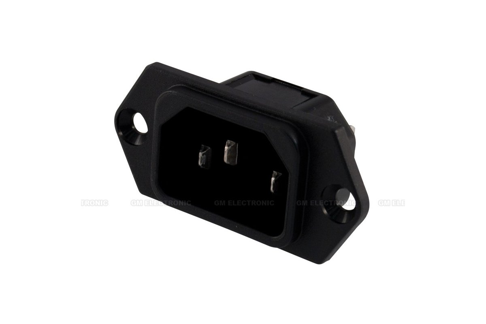
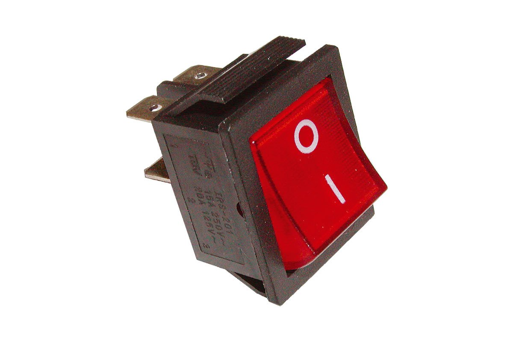
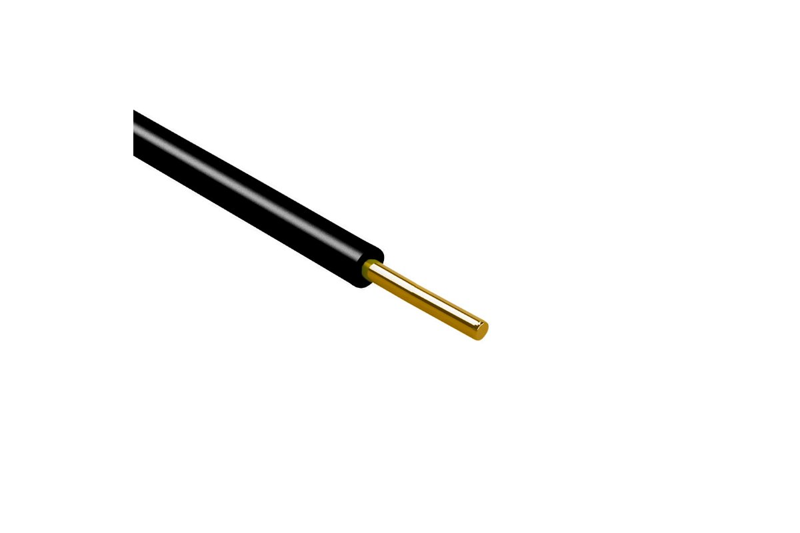
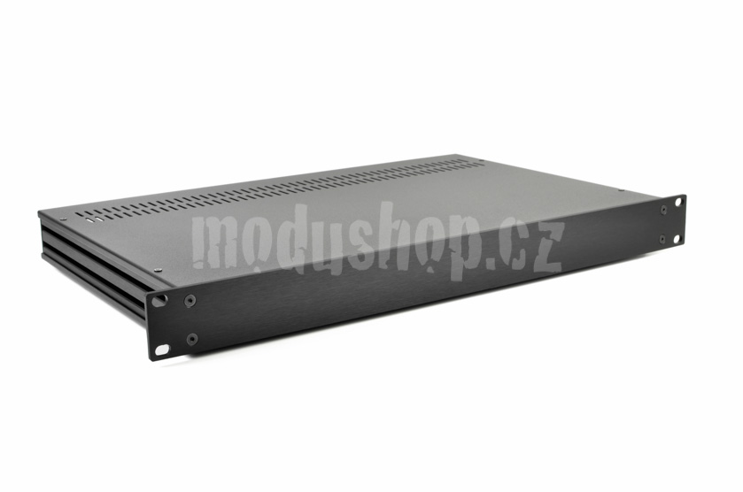
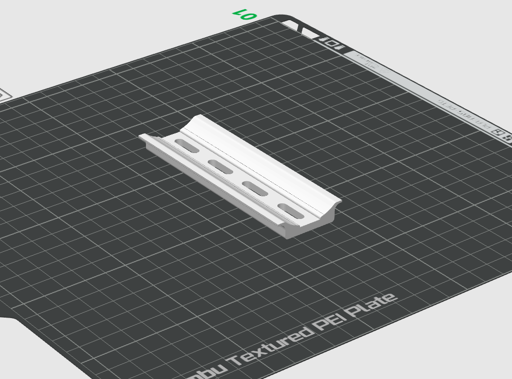

# RPI-PDU

[Overview](../../README.md) · [RPI-BOX](../box/README.md) · [RPI-BOX-Double](../box-double/README.md) · [Mains panel](../seq-pdu/README.md)

> [!WARNING]
> Disconnect the supply before you open the case.
> 230 V alternating current (AC) can kill you.
> Do this procedure only if you have approval for mains work.
> Obey the schematic.
> This page gives no more connection steps.

The RPI-PDU is a 1U power-supply unit for a 19-inch rack.
One unit supplies 20 [RPI-BOX](../box/README.md) units or 20 [RPI-BOX-Double](../box-double/README.md) units.
Each output is a GX12 cable.
Each output supplies 5 V direct current (DC) at 3 A.
The case can hold a maximum of two shelves of boxes.
Twenty outputs supply two shelves of standard boxes.
You put 10 of those boxes on end in each shelf.

The quantities in the tables are for one RPI-PDU.

> [!NOTE]
> The links in the tables go to example shops in Czechia.
> You can use a part that has the same specification.

---

## Parts

### Parts that you make

| ID       | Qty | Item                              | Photograph                                                                      |
| -------- | --- | --------------------------------- | ------------------------------------------------------------------------------- |
| `id_010` | 20× | Wire with a female GX12 connector |  |

- Use one cable `id_010` for one box.
- A cable shop can attach the female GX12 connector.
- This cable connects to the GX12 cable on the box.

### Parts that you buy

| ID       | Qty         | Item                                                             | Photograph                                                                                         |
| -------- | ----------- | ---------------------------------------------------------------- | -------------------------------------------------------------------------------------------------- |
| `id_110` | 2×          | [Power supply, Mean Well RS-150-5, 150 W, 5 V, enclosed][id_110] |                                 |
| `id_120` | 4×          | [Terminal bridge, neutral, 7 positions, blue][id_120]            |  |
| `id_130` | 4×          | [Terminal bridge, live, 7 positions, black][id_130]              |       |
| `id_140` | 1×          | [Inlet connector, IEC C14][id_140]                               |                       |
| `id_150` | 1×          | [Power switch, rocker type][id_150]                              |                           |
| `id_160` | As required | [Wire, single core, H07V-U, 1.5 mm²][id_160]                     |                                      |
| `id_170` | 1×          | [Rack case, 1U, 280 mm deep][id_170]                             |                                  |

The two 5 V power supplies together supply the 20 outputs.

### Parts that you print

| ID       | Qty | Material  | Item                        | Photograph                                                                    |
| -------- | --- | --------- | --------------------------- | ----------------------------------------------------------------------------- |
| `id_210` | 4×  | Black PLA | [DIN-rail segments][id_210] |             |
| `id_220` | 2×  | Black PLA | [Back panel][id_220]        |  |

The back panel holds these parts:

- The GX12 cables
- The power switch
- The mains inlet

The DIN-rail segments hold the terminal bridges.

---

## Connect the wires

> [!WARNING]
> Disconnect the supply before you open the case.
> 230 V AC can kill you.
> Obey the schematic for each connection.

1. Install the parts in the rack case.
2. Connect the parts as the schematic shows.
3. Use only the connections that the schematic shows.

Use these files:

- [Schematic, PDF](schematic.pdf)
- [Schematic source, QElectroTech](schematic.qet)

The schematic is a [QElectroTech](https://qelectrotech.org/) drawing.

The schematic shows these parts:

- Two 5 V power supplies
- The terminal bridges for the live wires
- The terminal bridges for the neutral wires
- The IEC C14 inlet
- The power switch
- The GX12 cables on the back panel

---

[id_110]: https://www.gme.cz/v/1505958/mean-well-rs-150-5-spinany-zdroj-pro-vestavbu-kryty
[id_120]: https://www.gme.cz/v/1497307/eleman-mustek-n-7-modry-nekryty
[id_130]: https://www.gme.cz/v/1498029/eleman-mustek-l-7-cerny-nekryty
[id_140]: https://www.gme.cz/v/1496789/schurter-61003300-konektor-ice-c14
[id_150]: https://www.gme.cz/v/1499819/irs-201-1c3-r-b-kolebkovy-spinac
[id_160]: https://www.gme.cz/v/1512210/elektrokabel-cy-1x15-cerny-h07v-u-izolovany-vodic-drat
[id_170]: https://www.modushop.cz/1SL01280N-1u-rack-krabice-s-listou-280mm-4mm-rack-panel-cerny.html
[id_210]: ../../models/pdu/DIN+Rails+50-250+mm.3mf
[id_220]: ../../models/pdu/RPIPDU_BackWall-miniXLRs_v14.3mf
