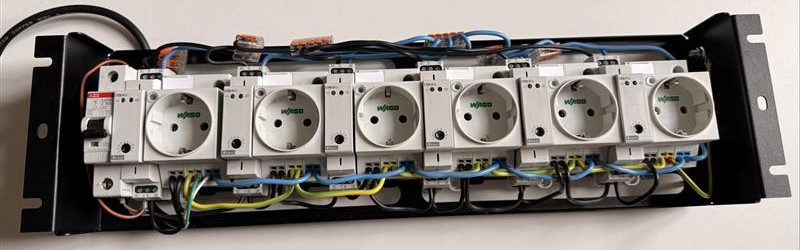
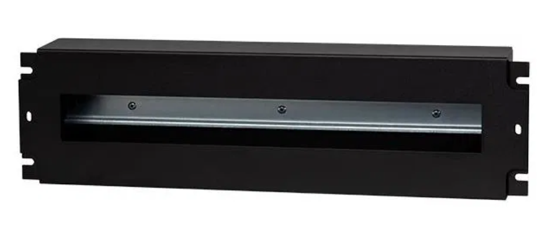
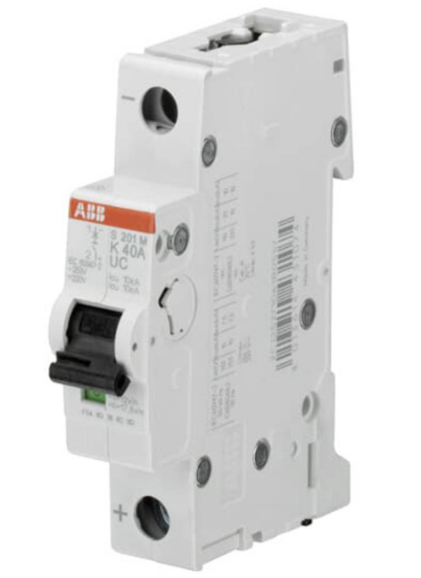
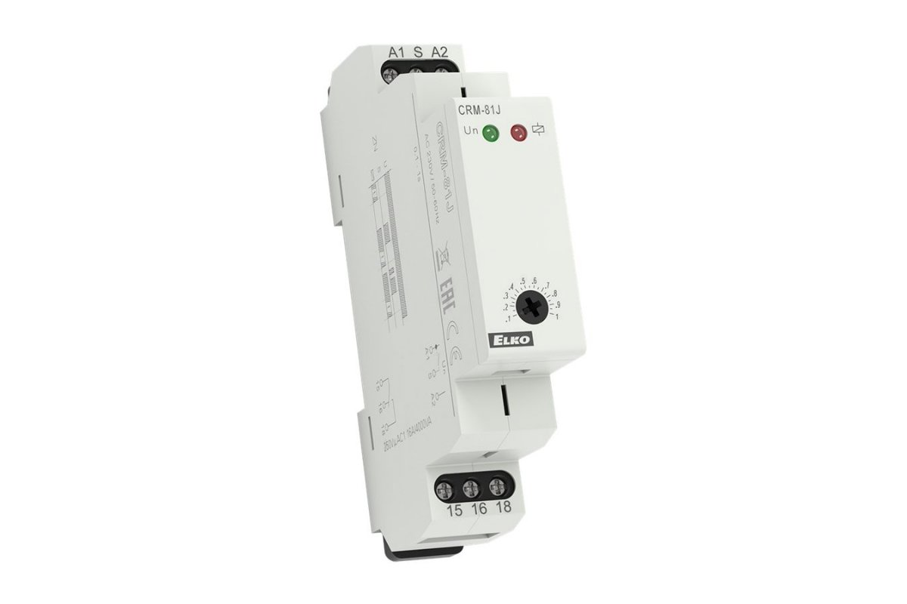
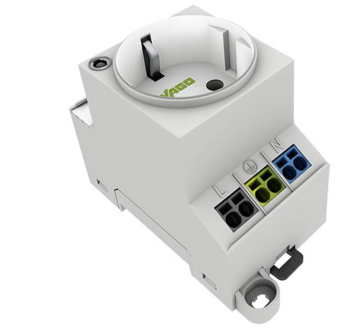

# SEQ-PDU

[Overview](../../README.md) · [Shelf power](../pdu/README.md)

> [!WARNING]
> Disconnect the supply before you open the cover.
> 230 V alternating current (AC) can kill you.
> Do this procedure only if you have approval for mains work.
> Obey the schematic.
> This page gives no more connection steps.

The SEQ-PDU is the mains panel for the rack.
The panel is a 3U breaker bar.
One panel supplies three rack shelves.

The panel has six sockets.
Each socket has a delay relay.
Each delay relay adjusts from 1 second to 10 seconds.
The sockets start one after the other.
This sequence decreases the current peak at the start of the rack.

The panel has a 16 A circuit breaker, type Z, before the sockets.
This circuit breaker opens before the larger upstream circuit breaker.
A fault then stays in this rack.

The quantities in the table are for one SEQ-PDU.

> [!NOTE]
> The links in the table go to example shops in Czechia.
> You can use a part that has the same specification.

---

## Parts

| ID       | Qty | Item                                                           | Photograph                                                                             |
| -------- | --- | -------------------------------------------------------------- | -------------------------------------------------------------------------------------- |
| `id_110` | 1×  | [Breaker bar, 3U, 19 inch, with cover, for a DIN rail][id_110] |        |
| `id_120` | 1×  | [Circuit breaker, 1 pole, type Z, 16 A][id_120]                |  |
| `id_130` | 6×  | [Delay relay, 1 second to 10 seconds][id_130]                  |                        |
| `id_140` | 6×  | [Socket for a DIN rail][id_140]                                |              |

---

## Connect the wires

> [!WARNING]
> Disconnect the supply before you open the cover.
> 230 V AC can kill you.
> Obey the schematic for each connection.

The schematic shows one socket channel.

1. Assemble that socket channel.
2. Repeat the assembly for each of the six positions.
3. Connect the six channels in parallel.
4. Use only the connections that the schematic shows.

Use these files:

- [Schematic, PDF](schematic.pdf)
- [Schematic source, QElectroTech](schematic.qet)

The schematic is a [QElectroTech](https://qelectrotech.org/) drawing.

Connect the [RPI-PDU](../pdu/README.md) to one of these sockets.

---

[id_110]: https://www.alza.cz/EN/ctnet-19-ctnet-3u-breaker-bar-with-cover-din-black-d8561626.htm
[id_120]: https://www.conrad.cz/cs/p/abb-2cds271061r0468-s201m-z16uc-elektricky-jistic-1polovy-2325487.html
[id_130]: https://www.gme.cz/v/1511263/elko-ep-crm-81j-uni-zn-1-10s-casove-rele
[id_140]: https://www.conrad.cz/cs/p/skrinovy-rozvadec-zasuvka-wago-sonstige-installationstechnik-bila-1-ks-1687410.html?refresh=true
